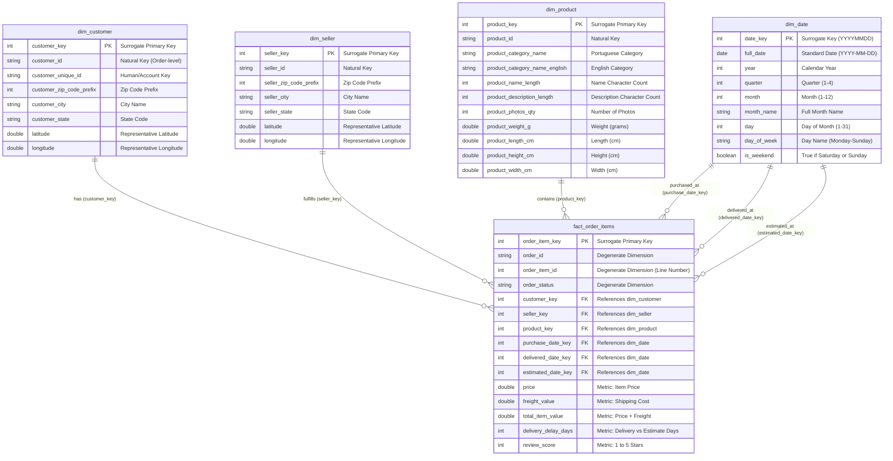

# 🛒 Olist Data Warehouse & Decision Support System (DW & DSS)

Dự án môn học **Kho dữ liệu và Hệ hỗ trợ Quyết định (CO4031)** — Đại học Bách Khoa ĐHQG-HCM.  
Hệ thống hoàn chỉnh gồm luồng **PySpark ETL**, kho dữ liệu **Parquet Star Schema**, tầng phân tích đa chiều **DuckDB OLAP**, phân hệ hỗ trợ quyết định **LightGBM DSS** và giao diện trực quan **React Dashboard**.

---

## 📂 1. Cấu trúc Dự án (Project Structure)

Mã nguồn và dữ liệu được phân chia theo cấu trúc:

```text
DW-ETL/
├── data/
│   ├── dataset/             # Dữ liệu nguồn Olist CSV thô (9 file, ~120 MB)
│   └── data_warehouse/      # Kho dữ liệu Parquet Star Schema (5 bảng đa chiều)
├── src/
│   ├── backend/             # FastAPI Backend API (OLAP & DSS)
│   │   ├── routers/         # Định tuyến /api/olap và /api/dss
│   │   ├── database.py      # Kết nối DuckDB nhúng & ánh xạ Parquet
│   │   └── main.py          # Điểm khởi chạy ứng dụng FastAPI
│   ├── dss/                 # Phân hệ Hỗ trợ Quyết định (Decision Support System)
│   │   ├── artifacts/       # Trọng số mô hình & metrics sau huấn luyện (gitignored)
│   │   ├── dss_pipeline.py  # Pipeline huấn luyện LightGBM & Time-series
│   │   └── features.py      # Trích xuất 18 đặc trưng & làm mượt Laplace
│   ├── etl/                 # Pipeline PySpark ETL (Extract - Transform - Load)
│   │   ├── env.py           # Kích hoạt OpenJDK 17 & Hadoop winutils cục bộ
│   │   ├── extract.py       # Đọc dữ liệu CSV từ data/dataset/
│   │   ├── fetch_data.py    # Tự động tải bộ dữ liệu Olist từ Kaggle
│   │   ├── load.py          # Xuất Star Schema Parquet vào data/data_warehouse/
│   │   ├── schema.py        # Hợp đồng kiểu dữ liệu cho 5 bảng
│   │   └── transform.py     # Biến đổi, làm sạch và gán khóa đại diện
│   └── frontend/            # Giao diện người dùng Web (React + Vite + TypeScript)
│       ├── src/             # Pages (Overview, OLAP, Delivery Risk, Sales Forecast)
│       └── package.json
├── conf/                    # Cấu hình log4j2 cho Apache Spark
├── tools/                   # OpenJDK 17 & Hadoop winutils cục bộ
├── setup_env.py             # Script tự động tải JDK 17 & Hadoop winutils
├── requirements.txt         # Danh sách thư viện Python phụ thuộc
└── .gitignore               # Tự động bỏ qua dữ liệu lớn và artifacts
```

---

## ⚡ 2. Hướng dẫn Chạy Nhanh (Setup & Run)

Chỉ cần làm theo các bước dưới đây để thiết lập môi trường, xây dựng kho dữ liệu và khởi động hệ thống:

### Bước 1: Kích hoạt Virtual Environment & Cài thư viện Python
```powershell
# Tạo và kích hoạt venv (nếu chưa có)
python -m venv .venv
.venv\Scripts\activate

# Cài đặt toàn bộ dependencies (PySpark, DuckDB, FastAPI, LightGBM, Scikit-learn,...)
pip install -r requirements.txt
```

### Bước 2: Thiết lập môi trường công cụ (Chỉ chạy 1 lần)
Script này sẽ tự động tải OpenJDK 17 di động và Hadoop winutils vào thư mục `tools/` (không cần cài Java lên hệ thống Windows):
```powershell
python setup_env.py
```

### Bước 3: Chạy ETL xây dựng Kho dữ liệu
Chạy pipeline để tự động tải bộ dữ liệu Olist từ Kaggle về `data/dataset/`, làm sạch, chuyển đổi sang Star Schema và lưu trữ vào `data/data_warehouse/`:
```powershell
python -m src.etl
# hoặc:
cd src && python -m etl && cd ..
```
*(Dữ liệu Star Schema Parquet nén sẽ được lưu trữ tự động trong `data/data_warehouse/`).*

### Bước 4: Huấn luyện và sinh Artifacts cho DSS (Chỉ chạy 1 lần hoặc khi train lại)
Huấn luyện 2 mô hình (Dự báo rủi ro giao hàng trễ & Dự báo chuỗi thời gian doanh số 28 ngày), tự động lưu kết quả vào `src/dss/artifacts/`:
```powershell
python -m src.dss
# hoặc:
cd src && python -m dss && cd ..
```

### Bước 5: Khởi động Backend API
```powershell
cd src/backend
uvicorn main:app --reload --port 8000
```
* **Base URL:** `http://localhost:8000`
* **Swagger UI (Xem và kiểm thử trực tiếp toàn bộ API OLAP & DSS):** [http://localhost:8000/docs](http://localhost:8000/docs)

### Bước 6: Khởi động Giao diện Frontend
Mở một terminal mới tại thư mục gốc dự án:
```powershell
cd src/frontend
npm.cmd ci
npm.cmd run dev -- --strictPort
```
* Mở trình duyệt tại: [http://127.0.0.1:5173/](http://127.0.0.1:5173/)

---

## 🧠 3. Phân Hệ Hỗ Trợ Quyết Định (DSS Module)

Mã nguồn DSS được tổ chức trong `src/dss/` và tích hợp vào Backend tại `src/backend/routers/dss.py`.

### Cấu trúc mô-đun:
* `src/dss/features.py`: Định nghĩa và tính toán 18 đặc trưng:
  * Khoảng cách địa lý **Haversine** từ tọa độ khách hàng và người bán.
  * Tỷ lệ cước phí vận chuyển, khối lượng, kích thước bưu kiện.
  * Lịch sử seller và prior toàn sàn chỉ dùng kết quả đã biết **trước ngày mua**, làm mượt bằng **Laplace Smoothing**. Khi chưa có lịch sử, prior cố định là 0.10 cho giao trễ và 3.0 cho review.
  * Chuyển đổi biến phân loại (State, Category) với fallback chống Out-of-Vocabulary (`UNK`, `other`).
* `src/dss/dss_pipeline.py`:
  * **Bài toán 1 - Late Delivery Risk:** Dùng **LightGBM Classifier**, chia train/validation/test theo thời gian. Đơn huấn luyện phải giao trước mốc cutoff; validation dùng để chọn số vòng học cũng phải có kết quả trước mốc bắt đầu test. Phân loại rủi ro thành `low`, `medium`, `high`.
  * **Bài toán 2 - Sales Forecasting:** Dự báo chuỗi thời gian cho 28 ngày kế tiếp (`orders` và `gmv`), khử mùa vụ và tính toán **Black Friday Uplift**, cung cấp khoảng tin cậy 80% (`lo` - `hi`).
* `src/dss/artifacts/`: Thư mục chứa các file sau khi chạy huấn luyện:
  * `model.joblib`: Trọng số mô hình dự báo giao trễ & lookups.
  * `sales_model.joblib` & `sales_forecast.json`: Dự báo doanh số 28 ngày.
  * `metrics.json` & `sales_metrics.json`: Các chỉ số đánh giá kỹ thuật (ROC-AUC, WAPE, Feature Importance).
  * `example_orders.json`: Dữ liệu mẫu đơn hàng thực tế phục vụ Frontend thử nghiệm.

---

## 🚀 4. Đặc tả RESTful API Backend

Backend viết bằng **FastAPI**, bật sẵn **CORS** cho phép giao diện web kết nối (`allow_origins=["*"]`).

### A. Nhóm API Phân Tích Đa Chiều OLAP (`/api/olap`)

| Phương thức | Endpoint | Chức năng | Tham số chính |
| --- | --- | --- | --- |
| `GET` | `/api/olap/kpis` | Lấy các chỉ số KPI tổng quan (doanh thu, số đơn, số item, điểm review, tỷ lệ đúng hạn) | `year`, `state`, `category` |
| `GET` | `/api/olap/sales-trend` | Xu hướng doanh số theo thời gian (Roll-up / Drill-down) | `granularity` (`year`/`quarter`/`month`), `year`, `state`, `category` |
| `GET` | `/api/olap/top-categories` | Xếp hạng ngành hàng bán chạy | `limit`, `by` (`revenue`/`volume`), `year`, `state`, `category` |
| `GET` | `/api/olap/geo-distribution` | Phân bố doanh số và ngày trễ theo bang Brazil | `year`, `state`, `category` |
| `GET` | `/api/olap/filters` | Danh sách năm, bang, ngành hàng để khởi tạo bộ lọc dropdown | Không có |
| `POST` | `/api/olap/execute-query` | Thực thi câu truy vấn SQL tùy biến chỉ đọc | Body: `{"query": "SELECT ..."}` |
| `GET` | `/api/olap/sample-queries` | Danh sách các mẫu truy vấn Roll-Up, Drill-Down, Slice, Dice | Không có |

### B. Nhóm API Hỗ Trợ Quyết Định DSS (`/api/dss`)

| Phương thức | Endpoint | Chức năng | Tham số / Body |
| --- | --- | --- | --- |
| `POST` | `/api/dss/predict-late-delivery` | Dự đoán xác suất và tầng rủi ro giao trễ cho đơn hàng mới | Body JSON: ngày mua, ngày hẹn, seller, category, giá, cước, tọa độ... |
| `GET` | `/api/dss/sales-forecast` | Lấy chuỗi dự báo 28 ngày kèm khoảng tin cậy 80% | `target` (`orders` hoặc `gmv`, mặc định `orders`) |
| `GET` | `/api/dss/late-delivery-metrics` | Lấy các chỉ số đánh giá kỹ thuật của mô hình giao trễ | Không có |
| `GET` | `/api/dss/sales-metrics` | Lấy các chỉ số đánh giá (WAPE, bias) của mô hình doanh số | Không có |
| `GET` | `/api/dss/example-orders` | Lấy danh sách 5 đơn hàng mẫu thực tế để thử nghiệm nhanh | Không có |

---

## 💻 5. Giao Diện Người Dùng (Frontend)

Frontend đặt trong `src/frontend/`, xây dựng trên **React 19 + Vite + TypeScript + Tailwind CSS + shadcn/ui**.

### Các trang chức năng chính:
* **Overview (`/`):** Hiển thị KPI cards tổng thể, biểu đồ doanh thu theo thời gian, biểu đồ top ngành hàng và bản đồ phân bố địa lý theo bang.
* **OLAP Analytics (`/olap`):** Cho phép Drill-down/Roll-up linh hoạt theo năm/quý/tháng, chạy các thao tác mẫu Slice/Dice và bảng điều khiển SQL Console trực tiếp.
* **Delivery Risk (`/delivery-risk`):** Form đánh giá rủi ro giao trễ, hỗ trợ tải đơn hàng mẫu tự động, tính xác suất và hiển thị huy hiệu tầng rủi ro (`low`, `medium`, `high`).
* **Sales Forecast (`/sales-forecast`):** Biểu đồ chuỗi thời gian dự báo 28 ngày cho số đơn hàng hoặc GMV kèm dải khoảng tin cậy 80% và bảng metrics chi tiết.

---

## 📐 6. Mô hình Dữ liệu Star Schema

Kho dữ liệu được thiết kế theo chuẩn Ralph Kimball gồm 1 bảng Fact trung tâm và 4 bảng Dimension:


