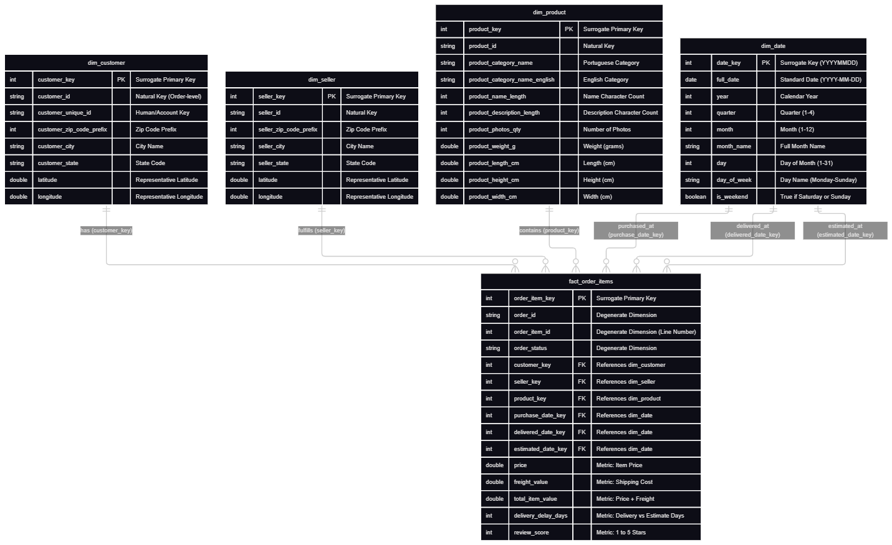
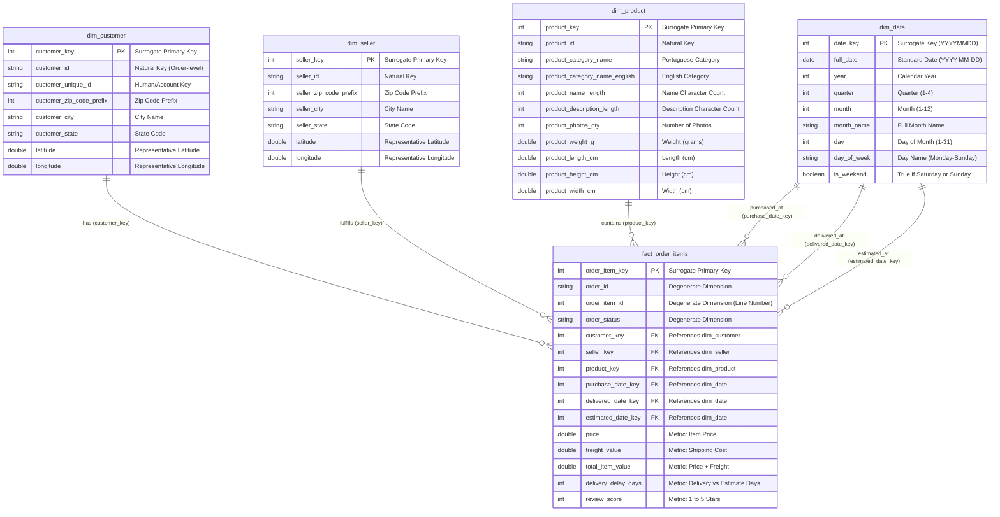

# 🛒 Olist Data Warehouse & Decision Support System (DW & DSS)

Tài liệu hướng dẫn nội bộ dành cho thành viên phát triển **Frontend** (UI/Dashboard) và **DSS** (Model/Decision Logic).

---

## ⚡ 1. Hướng dẫn Chạy Nhanh (Setup & Run)

Chỉ cần làm theo 5 bước dưới đây để có đầy đủ Database, Models và Backend API chạy trên máy:

### Bước 1: Kích hoạt Virtual Environment & Cài thư viện
```powershell
# Tạo và kích hoạt venv (nếu chưa có)
python -m venv .venv
.venv\Scripts\activate

# Cài đặt toàn bộ dependencies (PySpark, DuckDB, FastAPI, LightGBM, Scikit-learn,...)
pip install -r requirements.txt
```

### Bước 2: Setup công cụ (Chỉ chạy 1 lần duy nhất)
Script này sẽ tự động tải OpenJDK 17 và Hadoop winutils vào thư mục `tools/` (không cần cài Java lên máy tính):
```powershell
python setup_env.py
```

### Bước 3: Chạy ETL để sinh Data Warehouse
Chạy pipeline để tự động tải bộ dữ liệu Olist từ Kaggle về, transform và xuất ra các file Parquet:
```powershell
python -m etl
```
*(Sau khi chạy xong, dữ liệu Star Schema sẽ nằm sẵn trong thư mục `data_warehouse/`).*

### Bước 4: Huấn luyện và sinh Artifacts cho DSS (Chỉ chạy 1 lần hoặc khi train lại)
Huấn luyện 2 mô hình (Dự báo rủi ro giao hàng trễ & Dự báo chuỗi thời gian doanh số), tự động lưu kết quả vào `dss/artifacts/`:
```powershell
python -m dss
```

### Bước 5: Khởi động Backend API
```powershell
cd backend
uvicorn main:app --reload --port 8000
```
* **Base URL:** `http://localhost:8000`
* **Swagger UI (Xem và test trực tiếp toàn bộ API OLAP & DSS):** [http://localhost:8000/docs](http://localhost:8000/docs)

---

## 🧠 2. Phân Hệ Hỗ Trợ Quyết Định (DSS Module)

Mã nguồn DSS được tổ chức trong thư mục `dss/` và tích hợp vào Backend tại `backend/routers/dss.py`.

### Cấu trúc mô-đun:
* `dss/features.py`: Định nghĩa và tính toán các đặc trưng:
  * Khoảng cách địa lý **Haversine** từ tọa độ khách hàng và người bán.
  * Tỷ lệ cước phí vận chuyển, khối lượng, kích thước bưu kiện.
  * Lịch sử seller và prior toàn sàn chỉ dùng kết quả đã biết **trước ngày mua**, làm mượt bằng **Laplace Smoothing**. Khi chưa có lịch sử, prior cố định là 0.10 cho giao trễ và 3.0 cho review.
  * Chuyển đổi biến phân loại (State, Category) với fallback chống Out-of-Vocabulary.
* `dss/dss_pipeline.py`:
  * **Bài toán 1 - Late Delivery Risk:** Dùng **LightGBM Classifier**, chia train/validation/test theo thời gian. Đơn huấn luyện phải giao trước mốc cutoff; validation dùng để chọn số vòng học cũng phải có kết quả trước mốc bắt đầu test. Vocabulary và median của baseline chỉ fit trên tập huấn luyện tương ứng; backtest fit lại theo từng mốc. Phân loại rủi ro thành `low`, `medium`, `high`.
  * **Bài toán 2 - Sales Forecasting:** Dự báo chuỗi thời gian cho 28 ngày kế tiếp (`orders` và `gmv`), khử mùa vụ và tính toán **Black Friday Uplift**, cung cấp khoảng tin cậy 80% (`lo` - `hi`).
* `dss/artifacts/`: Thư mục chứa các file sau khi chạy `python -m dss`:
  * `model.joblib`: Weights mô hình dự báo giao trễ & lookups.
  * `sales_model.joblib` & `sales_forecast.json`: Dự báo doanh thu 28 ngày.
  * `metrics.json` & `sales_metrics.json`: Các chỉ số đánh giá kỹ thuật (ROC-AUC, WAPE, Feature Importance).
  * `example_orders.json`: Dữ liệu mẫu đơn hàng thực tế phục vụ Frontend thử nghiệm.

### Quan hệ giữa `dim_date` và DSS

- Mỗi item nối `dim_date` ba lần: ngày mua để chia tập/tạo feature; ngày hẹn để tính thời gian cam kết; ngày giao thật để xác định khi nào nhãn giao trễ đã được biết. DSS kiểm tra lịch liên tục, khóa duy nhất và cả ba khóa ngoại trước khi tải dữ liệu; nếu thiếu khóa hoặc phép nối làm thay đổi số item hợp lệ, pipeline báo lỗi và yêu cầu dựng lại warehouse.
- Lịch sử seller khi train và khi phục vụ API dùng cùng quy tắc thời gian. Kết quả giao chỉ được tính khi ngày giao nhỏ hơn ngày mua cần dự đoán. Warehouse chưa giữ thời điểm review thực tế, nên **review được giả định sẵn có sau ngày giao 7 ngày**; đây là giả định của mô hình. Điểm review thiếu không được coi là một review đã quan sát.
- `dim_date` có thể kéo dài qua ngày mua cuối cùng vì còn ngày giao/hẹn giao. Forecast chỉ lấy lịch sử từ các **purchase facts** hợp lệ; không kéo dài chuỗi bán hàng bằng các số 0 tới ngày cuối của dimension. Chỉ các ngày trống bên trong khoảng lịch sử bán hàng mới được điền 0.
- Sau khi chạy lại ETL hoặc thay đổi cách tạo feature, chạy `python -m dss` để sinh lại artifacts, rồi khởi động lại backend nếu model cũ đã được nạp vào bộ nhớ.

### Lệnh huấn luyện lại mô hình:
```powershell
python -m dss
```

---

## 🎨 3. Dành cho bạn làm Frontend (UI / Dashboard)

Backend viết bằng FastAPI, đã bật sẵn **CORS** cho mọi domain (`allow_origins=["*"]`). Bạn có thể dùng Streamlit, React, Next.js, Vue hoặc HTML/JS thuần tùy ý.

---

### A. Các API Phân Tích OLAP (`/api/olap`)

Các ví dụ JSON dưới đây minh họa cấu trúc; số liệu phụ thuộc dữ liệu và bộ lọc.

**Bộ lọc chung cho cả bốn API `kpis`, `sales-trend`, `top-categories`, `geo-distribution`:**

| Tham số | Kiểu | Ý nghĩa |
| --- | --- | --- |
| `year` | int, 1–9999 | Năm **mua hàng**, không phải năm giao hàng. Bỏ qua tham số để lấy mọi năm. |
| `state` | chuỗi gồm 2 chữ cái | Bang của **khách hàng**, ví dụ `SP`. Chấp nhận `sp` và chuẩn hóa thành `SP`. |
| `category` | chuỗi không rỗng | Tên ngành hàng tiếng Anh từ `/api/olap/filters`. |

Các bộ lọc kết hợp bằng **AND**. Khi người dùng chọn "Tất cả", frontend không gửi tham số tương ứng, tránh gửi chuỗi rỗng. `/filters` trả danh sách lựa chọn đầy đủ, không lọc dây chuyền theo lựa chọn hiện tại.

- Không có dữ liệu: các API biểu đồ trả `[]`; KPI trả doanh thu/số lượng bằng `0`, điểm review và tỷ lệ đúng hạn bằng `null`.
- `orders` là số đơn khác nhau trong từng nhóm; `total_items` là số dòng sản phẩm. KPI tổng quan dùng `total_orders` và `total_items`.
- `revenue`/`total_revenue` hiện cộng **giá sản phẩm + phí vận chuyển**, gồm mọi trạng thái đơn hàng. Đây là giá trị giao dịch theo định nghĩa hiện tại, không phải doanh thu thực thu.
- Điểm review và tỷ lệ đúng hạn đang tính theo **item**. `on_time_rate` dùng thang `0–100`; `null` nghĩa là chưa có dữ liệu để tính.
- Tham số sai kiểu/giá trị cho phép, ví dụ `granularity=day`, `by=other`, `limit=0`, trả **HTTP 422** với trường `detail`.
- Tên từ bản API cũ đã được thay: `interval` → `granularity`, `order_count`/`orders_count` → `orders`, `items_sold` → `total_items`. Frontend mới dùng các tên trong tài liệu này.

#### 1. Lấy dữ liệu cho các thẻ KPI (`/api/olap/kpis`)
Dùng để hiển thị các con số tổng quan ở đầu Dashboard. Hỗ trợ bộ lọc Slice / Dice:
* **Method:** `GET`
* **Params (Optional):** `year` (int), `state` (str, ví dụ: "SP"), `category` (str)
* **Ví dụ:** `/api/olap/kpis?year=2018&state=SP`
* **Response:**
  ```json
  {
    "total_revenue": 1254300.50,
    "total_orders": 8500,
    "total_items": 9800,
    "avg_review_score": 4.15,
    "on_time_rate": 92.4
  }
  ```

#### 2. Biểu đồ doanh thu theo thời gian (`/api/olap/sales-trend`)
Dùng cho biểu đồ đường (Line chart) thể hiện tính năng **Drill-down / Roll-up**:
* **Method:** `GET`
* **Params:** 
  * `granularity` (Optional, mặc định `"month"`): `"month"`, `"quarter"`, hoặc `"year"`
  * Bộ lọc chung (Optional): `year`, `state`, `category`
* **Ví dụ:** `/api/olap/sales-trend?granularity=month&year=2018`
* **Response:**
  ```json
  [
    {"period": "2018-01", "revenue": 111500.2, "orders": 820},
    {"period": "2018-02", "revenue": 120400.8, "orders": 890}
  ]
  ```
* `period` luôn là **chuỗi**: `"2018-01"` theo tháng, `"2018-Q1"` theo quý, `"2018"` theo năm. Kết quả xếp theo thời gian tăng dần.

#### 3. Top ngành hàng bán chạy (`/api/olap/top-categories`)
Dùng cho biểu đồ cột (Bar chart):
* **Method:** `GET`
* **Params (Optional):** 
  * `limit`: Số lượng top, từ `1` đến `50` (mặc định `10`)
  * `by`: `"revenue"` (mặc định, theo doanh thu) hoặc `"volume"` (theo số item `total_items`)
  * Bộ lọc chung: `year`, `state`, `category`
* **Ví dụ:** `/api/olap/top-categories?year=2018&state=SP&by=volume&limit=10`
* **Response:**
  ```json
  [
    {"category": "bed_bath_table", "revenue": 1036000.0, "total_items": 11115, "avg_review_score": 4.0},
    {"category": "health_beauty", "revenue": 998000.0, "total_items": 9670, "avg_review_score": 4.2}
  ]
  ```
* Xếp giảm dần theo `by`; nếu bằng nhau, xếp tên category tăng dần. `avg_review_score` có thể là `null` khi chưa có review.

#### 4. Phân bổ doanh số theo Bang (`/api/olap/geo-distribution`)
Dùng để vẽ bản đồ nhiệt (Heatmap) hoặc bảng phân tích theo 27 bang của Brazil:
* **Method:** `GET`
* **Params (Optional):** Bộ lọc chung `year`, `state`, `category`.
* **Ví dụ:** `/api/olap/geo-distribution?year=2018&category=health_beauty`
* **Response:**
  ```json
  [
    {"state": "SP", "revenue": 5200000.0, "orders": 41746, "avg_freight": 18.0, "avg_delay_days": -8.0},
    {"state": "RJ", "revenue": 1800000.0, "orders": 12852, "avg_freight": 22.0, "avg_delay_days": -5.0}
  ]
  ```
* Xếp giảm dần theo doanh thu. `avg_delay_days` âm nghĩa là giao sớm hơn ngày hẹn. `state`, `avg_freight`, `avg_delay_days` có thể là `null` nếu thiếu dữ liệu tương ứng.

#### 5. Danh sách các lựa chọn cho Dropdown Filter (`/api/olap/filters`)
Dùng để nạp danh sách các năm, bang, ngành hàng vào các bộ lọc Dropdown:
* **Method:** `GET`
* **Response:**
  ```json
  {
    "years": [2016, 2017, 2018],
    "states": ["MG", "RJ", "SP"],
    "categories": ["computers_accessories", "health_beauty"]
  }
  ```
* Các danh sách được xếp tăng dần; ví dụ trên rút gọn states/categories. `years` lấy theo năm mua có trong fact. Categories không gồm `unknown`.

#### 6. Chạy câu truy vấn SQL tùy biến (`/api/olap/execute-query`)
Dành cho trang **OLAP Query Console** (Cho phép người dùng nhập SQL tùy biến và xem kết quả trực tiếp):
* **Method:** `POST`
* **Body:** `{"query": "SELECT c.customer_state AS state, COUNT(DISTINCT f.order_id) AS orders FROM fact_order_items f JOIN dim_customer c ON f.customer_key = c.customer_key GROUP BY 1 ORDER BY orders DESC LIMIT 2"}`
* **Response:**
  ```json
  {
    "columns": ["state", "orders"],
    "data": [
      {"state": "SP", "orders": 41746},
      {"state": "RJ", "orders": 12852}
    ],
    "row_count": 2
  }
  ```
* Tên cột trong `data` do SQL/alias quyết định. Giá trị SQL NULL trả JSON `null`. Lỗi cú pháp hoặc truy vấn bị chặn trả **HTTP 400**, dạng `{"detail": "..."}`.

#### 7. Mẫu thao tác OLAP (`/api/olap/sample-queries`)
* **Method:** `GET`
* **Response:** Object có các khóa `Roll-Up`, `Drill-Down`, `Slice`, `Dice`; mỗi mục có `description` và `sql`.
* Frontend có thể dùng các mục làm nút chọn mẫu, sau đó gửi `sql` sang `/api/olap/execute-query`.

---

### B. Các API Hỗ Trợ Quyết Định DSS (`/api/dss`)

Bộ lọc `year`, `state`, `category` của dashboard OLAP không áp dụng cho các artifacts DSS. `/sales-forecast` có lựa chọn `target` riêng; form dự đoán nhận dữ liệu từng đơn hàng.

#### 1. Dự đoán rủi ro đơn hàng giao trễ (`/api/dss/predict-late-delivery`)
Dùng cho Form đánh giá rủi ro đơn hàng mới:
* **Method:** `POST`
* **Body (JSON):**
  ```json
  {
    "purchase_date": "2018-08-15",
    "estimated_date": "2018-08-28",
    "seller_id": "4a3ca9315b744ce9f8e9374361493884",
    "category": "bed_bath_table",
    "n_items": 1,
    "total_price": 120.0,
    "total_freight": 25.5,
    "total_weight_g": 1200.0,
    "total_volume_cm3": 8000.0,
    "max_dim_cm": 30.0,
    "c_lat": -23.5505,
    "c_lng": -46.6333,
    "c_state": "SP",
    "s_lat": -22.9068,
    "s_lng": -43.1729,
    "s_state": "RJ"
  }
  ```
* Bắt buộc: `purchase_date`, `estimated_date`, `seller_id`, `category`, `n_items`, `total_price`, `total_freight`, `c_state`, `s_state`. Gửi ngày dưới dạng chuỗi `YYYY-MM-DD`.
* Các trường cân nặng, thể tích, kích thước và tọa độ là tùy chọn; có thể bỏ qua hoặc gửi `null`.
* **Validation đầu vào (HTTP 422 khi vi phạm):**
  * Ngày phải tồn tại trong lịch và đúng `YYYY-MM-DD`; không nhận timestamp, chuỗi ngày kèm giờ hoặc dạng `DD/MM/YYYY`. Khoảng ngày hỗ trợ là `1677-09-22` đến `2262-04-11`.
  * `estimated_date` phải bằng hoặc sau `purchase_date`. Khoảng cách tối đa là `106751` ngày theo giới hạn xử lý thời gian.
  * `n_items` là số nguyên JSON lớn hơn `0`; không gửi chuỗi `"1"`, số lẻ hoặc boolean.
  * `total_price`, `total_freight` không âm; giá/phí bằng `0` được chấp nhận. Các giá trị cân nặng, thể tích, kích thước nếu gửi cũng phải không âm. Số phải hữu hạn.
* Lỗi có dạng `{"detail": [{"loc": ["body", "estimated_date"], "msg": "Value error, Ngày hẹn giao phải bằng hoặc sau ngày mua.", "type": "value_error"}]}`; ví dụ đã lược bỏ metadata khác của lỗi. Frontend dùng phần tử cuối của `loc` để gắn thông báo vào ô nhập tương ứng, không gọi tiếp bước dự đoán khi còn lỗi.
* **Response:**
  ```json
  {
    "late_probability": 0.3842,
    "risk_tier": "high",
    "thresholds": {
      "medium": 0.0511,
      "high": 0.1070
    }
  }
  ```
* `late_probability` dùng thang `0–1`; frontend nhân `100` khi hiển thị phần trăm. `risk_tier` là `low`, `medium` hoặc `high`.
* `thresholds` lấy từ model và có thể đổi sau khi train lại; số trên chỉ minh họa. Dùng `risk_tier` từ response, không hard-code ngưỡng trên frontend.

#### 2. Lấy dự báo bán hàng 28 ngày (`/api/dss/sales-forecast`)
Dùng cho biểu đồ dự báo xu hướng tương lai:
* **Method:** `GET`
* **Params:** `target` (`"orders"` hoặc `"gmv"`, mặc định là `"orders"`)
* **Ví dụ:** `/api/dss/sales-forecast?target=orders`
* **Response:** `forecast` có `horizon_days` phần tử, thường là `28`. Ví dụ dưới chỉ trích phần tử đầu:
  ```json
  {
    "target": "orders",
    "horizon_days": 28,
    "forecast": [
      {
        "date": "2018-09-04",
        "forecast": 215.4,
        "lo": 182.5,
        "hi": 251.2,
        "event": false
      }
    ]
  }
  ```
* `date` là chuỗi `YYYY-MM-DD`, `lo`/`hi` là cận dưới/trên của khoảng dự báo, `event` đánh dấu ngày trong cửa sổ sự kiện. `target` không hợp lệ trả **HTTP 422**.
* Hiện artifacts dự báo giai đoạn **04/09/2018–01/10/2018** sau mốc dữ liệu bán hàng 03/09/2018. Đây là dự báo trên dữ liệu lịch sử, không phải 28 ngày kể từ ngày hiện tại.
* `gmv` chỉ cộng giá sản phẩm, không cộng phí vận chuyển và loại đơn canceled/unavailable; khác định nghĩa revenue của OLAP.

#### 3. Lấy mẫu đơn hàng có sẵn để test nhanh (`/api/dss/example-orders`)
Dùng để gắn nút bấm "Tải đơn hàng mẫu" trên giao diện, tự động điền form dự đoán:
* **Method:** `GET`
* **Response:** Object `{ "examples": [...], "count": 5 }`, trong đó `count` bằng số phần tử của `examples`. Artifacts hiện sinh 5 đơn mẫu.
* Mỗi phần tử có các trường giống body dự đoán ở trên và thêm `_actual_late` (bool), là kết quả lịch sử để đối chiếu, không phải feature đầu vào model.
* Các đơn mẫu là dữ liệu lịch sử và model cuối được fit lại trên toàn bộ tập có nhãn. Dùng chúng để demo form; không dùng kết quả trên các đơn mẫu để tuyên bố độ chính xác kiểm thử độc lập.
* Ví dụ sử dụng trên frontend:
  ```javascript
  const { examples, count } = await fetch('/api/dss/example-orders').then(r => r.json());
  const { _actual_late, ...payload } = examples[0];
  // Điền form bằng payload; gửi payload tới /api/dss/predict-late-delivery.
  ```

#### 4. Các API Metrics mô hình (`/api/dss/late-delivery-metrics` & `/api/dss/sales-metrics`)
Dùng để hiển thị bảng đánh giá độ chính xác của các mô hình DSS (ROC-AUC, Feature Importance, WAPE theo ngày/tuần).
* **Method:** `GET` cho cả hai endpoint.
* `/late-delivery-metrics`: Object gồm `validation`, `test`, `baseline`, `backtest`, `risk_tiers`, `tier_thresholds`, `feature_importance`, `data_window`. `data_window` ghi số đơn, khoảng ngày mua/giao, kết quả kiểm tra `dim_date` và giả định `review_lag_days`.
* `/sales-metrics`: Object có hai khóa `orders`, `gmv`; mỗi mục gồm `chosen`, `backtest`, `interval_80`, `event_uplift`.
* Nếu model/forecast/metrics/example artifacts cần thiết chưa được tạo, các API DSS tương ứng trả **HTTP 503**, dạng `{"detail": "..."}`. Chạy `python -m dss` trước khi dùng các API này.

---

## 📐 4. Star Schema Reference (Cấu trúc Bảng)

Mô hình dữ liệu Star Schema chuẩn Ralph Kimball được lưu trữ tại [docs/schema.png](docs/schema.png) và định nghĩa mã nguồn Mermaid tại [docs/schema.mmd](docs/schema.mmd):



<details>
<summary><b>🔍 Bấm để xem chi tiết mã nguồn Mermaid (Schema ERD)</b></summary>



</details>
