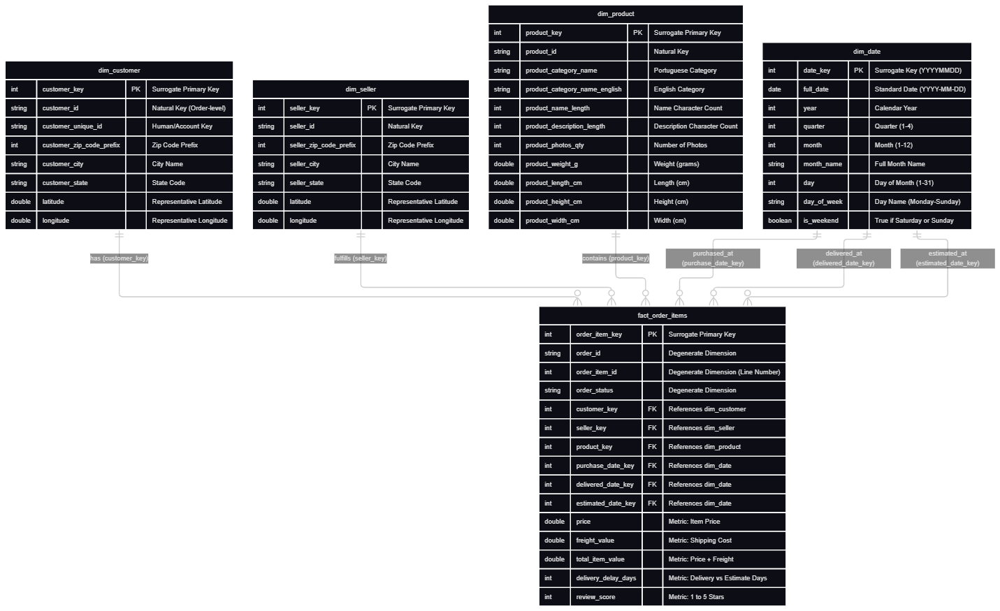
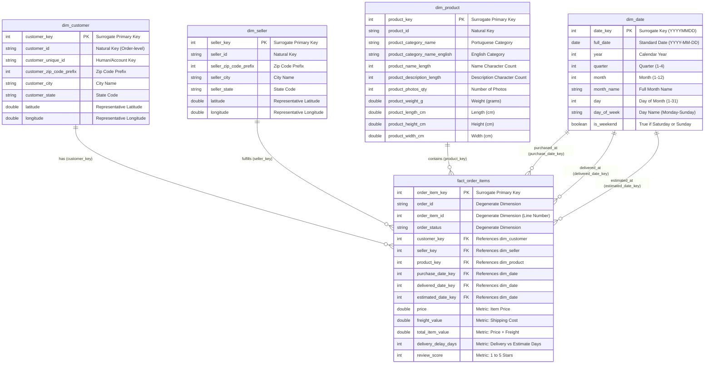

# 🛒 Olist Data Warehouse & Decision Support System (DW & DSS)

Tài liệu hướng dẫn nội bộ dành cho thành viên phát triển **Frontend** (UI/Dashboard) và **DSS** (Model/Decision Logic).

---

## ⚡ 1. Hướng dẫn Chạy Nhanh (Setup & Run)

Chỉ cần làm theo 4 bước dưới đây để có đầy đủ Database và Backend API chạy trên máy:

### Bước 1: Kích hoạt Virtual Environment & Cài thư viện
```powershell
# Tạo và kích hoạt venv (nếu chưa có)
python -m venv .venv
.venv\Scripts\activate

# Cài đặt dependencies
pip install -r requirements.txt
```

### Bước 2: Setup công cụ (Chỉ chạy 1 lần duy nhất)
Script này sẽ tự động tải OpenJDK 17 và Hadoop winutils vào thư mục `tools/` (không cần cài Java lên máy tính):
```powershell
python setup_env.py
```

### Bước 3: Chạy ETL để sinh Data Warehouse
Chạy pipeline để tự động kéo data Olist từ Kaggle về, transform và xuất ra các file Parquet:
```powershell
python -m etl
```
*(Sau khi chạy xong, dữ liệu Star Schema sẽ nằm sẵn trong thư mục `data_warehouse/`).*

### Bước 4: Khởi động Backend API
```powershell
cd backend
uvicorn main:app --reload --port 8000
```
* **Base URL:** `http://localhost:8000`
* **Swagger UI (Xem và test trực tiếp API):** [http://localhost:8000/docs](http://localhost:8000/docs)

---

## 🧠 2. Dành cho bạn làm DSS (Data & Model)

### Dữ liệu nằm ở đâu?
Dữ liệu đã được chuẩn hóa theo mô hình Star Schema và lưu trữ dưới dạng **Parquet** trong thư mục `data_warehouse/`:
* `data_warehouse/fact_order_items/`
* `data_warehouse/dim_customer/`
* `data_warehouse/dim_seller/`
* `data_warehouse/dim_product/`
* `data_warehouse/dim_date/`

### Cách đọc dữ liệu bằng Python (DuckDB / Pandas)
Bạn có thể đọc trực tiếp các bảng Parquet thành Pandas DataFrame chỉ với vài dòng:
```python
import duckdb

con = duckdb.connect()

# Đọc Fact kết hợp Dimension để lấy features train model
df = con.execute("""
    SELECT 
        f.price,
        f.freight_value,
        f.delivery_delay_days,
        f.review_score,
        c.customer_state,
        s.seller_state,
        CASE WHEN c.customer_state != s.seller_state THEN 1 ELSE 0 END AS is_interstate,
        p.product_category_name_english,
        p.product_weight_g
    FROM 'data_warehouse/fact_order_items/*.parquet' f
    LEFT JOIN 'data_warehouse/dim_customer/*.parquet' c ON f.customer_key = c.customer_key
    LEFT JOIN 'data_warehouse/dim_seller/*.parquet' s ON f.seller_key = s.seller_key
    LEFT JOIN 'data_warehouse/dim_product/*.parquet' p ON f.product_key = p.product_key
""").df()
```

---

## 🎨 3. Dành cho bạn làm Frontend (UI / Dashboard)
### Các API OLAP có sẵn để gọi:

#### 1. Lấy dữ liệu cho các thẻ KPI (`/api/olap/kpis`)
Dùng để hiển thị các con số tổng quan ở đầu Dashboard. Hỗ trợ bộ lọc Slice / Dice:
* **Method:** `GET`
* **Params (Optional):** `year` (int), `state` (str, ví dụ: "SP"), `category` (str)
* **Ví dụ:** `/api/olap/kpis?year=2018&state=SP`
* **Response:**
  ```json
  {
    "total_revenue": 1254300.50,
    "total_orders": 8500,
    "total_items": 9800,
    "avg_review_score": 4.15,
    "on_time_rate": 92.4
  }
  ```

#### 2. Biểu đồ doanh thu theo thời gian (`/api/olap/sales-trend`)
Dùng cho biểu đồ đường (Line chart) thể hiện tính năng **Drill-down / Roll-up**:
* **Method:** `GET`
* **Params:** 
  * `granularity` (Bắt buộc): `"month"`, `"quarter"`, hoặc `"year"`
  * `year` (Optional): Lọc theo năm cụ thể
* **Ví dụ:** `/api/olap/sales-trend?granularity=month&year=2018`
* **Response:**
  ```json
  [
    {"period": "2018-01", "revenue": 111500.2, "orders": 820},
    {"period": "2018-02", "revenue": 120400.8, "orders": 890}
  ]
  ```

#### 3. Top ngành hàng bán chạy (`/api/olap/top-categories`)
Dùng cho biểu đồ cột (Bar chart):
* **Method:** `GET`
* **Params (Optional):** 
  * `limit`: Số lượng top (Mặc định: 10)
  * `by`: `"revenue"` (theo doanh thu) hoặc `"volume"` (theo số lượng bán)
* **Response:**
  ```json
  [
    {"category": "bed_bath_table", "revenue": 1036000.0, "total_items": 11115},
    {"category": "health_beauty", "revenue": 998000.0, "total_items": 9670}
  ]
  ```

#### 4. Phân bổ doanh số theo Bang (`/api/olap/geo-distribution`)
Dùng để vẽ bản đồ nhiệt (Heatmap) hoặc bảng phân tích theo 27 bang của Brazil:
* **Method:** `GET`
* **Response:**
  ```json
  [
    {"state": "SP", "revenue": 5200000.0, "orders": 41746},
    {"state": "RJ", "revenue": 1800000.0, "orders": 12852}
  ]
  ```

#### 5. Danh sách các lựa chọn cho Dropdown Filter (`/api/olap/filters`)
Dùng để load danh sách các năm, bang, ngành hàng đưa vào các thanh Dropdown chọn lựa:
* **Method:** `GET`
* **Response:**
  ```json
  {
    "years": [2016, 2017, 2018],
    "states": ["SP", "RJ", "MG", ...],
    "categories": ["health_beauty", "computers_accessories", ...]
  }
  ```

#### 6. Chạy câu truy vấn SQL tùy biến (`/api/olap/execute-query`)
Dành cho trang **OLAP Query Console** (Cho phép giảng viên/người dùng nhập SQL và xem kết quả):
* **Method:** `POST`
* **Body:** `{"query": "SELECT c.customer_state, COUNT(*) FROM fact_order_items f JOIN dim_customer c ON f.customer_key = c.customer_key GROUP BY 1"}`
* **Response:** Trả về danh sách records JSON và số dòng.

---

## 📐 4. Star Schema Reference (Cấu trúc Bảng)

Mô hình dữ liệu Star Schema chuẩn Ralph Kimball được lưu trữ tại [docs/schema.png](docs/schema.png) và định nghĩa mã nguồn Mermaid tại [docs/schema.mmd](docs/schema.mmd):



<details>



</details>
